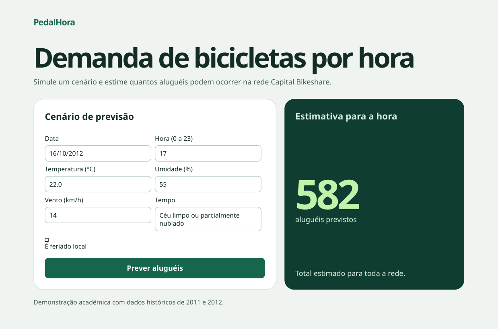

# PedalHora

**Demo Day de IA · Desafio 3 — Previsão de aluguel de bicicletas**

A PedalHora ajuda a equipe de operações de um sistema de bicicletas compartilhadas a estimar a demanda de uma hora. A operação pode usar a estimativa para identificar horários que merecem atenção no planejamento da disponibilidade de bicicletas. A unidade da previsão é o total de aluguéis por hora na rede.

## Integrantes

| Nome completo | R.A. |
| --- | --- |
| Pedro Henrique Marques | 2358464 |
| A preencher | A preencher |
| A preencher | A preencher |
| A preencher | A preencher |

Complete os nomes e R.A.s do grupo antes de enviar o link. A turma deve confirmar a disponibilidade do desafio, que tem limite de dois grupos.

## Dados e método

Usamos os registros horários do Capital Bikeshare de 2011 e 2012, obtidos do UCI Machine Learning Repository. O conjunto está incluído em `dados/hour.csv` sob licença CC BY 4.0. Referência: Hadi Fanaee-T (2013), [Bike Sharing](https://doi.org/10.24432/C5W894), UCI Machine Learning Repository. [Licença CC BY 4.0](https://creativecommons.org/licenses/by/4.0/).

A divisão foi cronológica, com cerca de 60% para treino, 20% para validação e 20% para teste. A rede usa calendário e clima. As contagens de usuários casuais e registrados ficaram fora das entradas porque somam o alvo `cnt`. A arquitetura foi escolhida pelo menor erro absoluto médio (MAE) de validação. O teste foi reservado para uma única comparação final.

## Resultados

Rede selecionada na validação: **96 × 48 neurônios**. Teste final: 3.476 registros horários, de 07/08/2012 a 31/12/2012.

| Modelo | MAE de teste (aluguéis/hora) |
| --- | ---: |
| Baseline | 116,63 |
| Árvore de decisão | 104,35 |
| Rede Keras | 89,27 |

**Frase de negócio.** No período de teste, a PedalHora estimou o total de aluguéis da rede com erro médio de 89,27 aluguéis por hora, uma redução de 23,5% no erro da regra histórica.

## Tela de previsão



A imagem foi renderizada a partir da resposta da tela para o cenário inicial, com 582 aluguéis previstos.

## Como rodar

Use Python 3.12 de 64 bits e abra um terminal na pasta que contém este README.

```sh
python -m venv .venv
```

Ative o ambiente:

- Windows PowerShell · `.venv\Scripts\Activate.ps1`
- Linux ou macOS · `source .venv/bin/activate`

```sh
python -m pip install -r requirements.txt
python app.py
```

Abra [http://127.0.0.1:5000](http://127.0.0.1:5000) e clique em **Prever aluguéis** para simular o cenário preenchido. A tela usa o modelo salvo e funciona sem chaves de API.

Para abrir os resultados ou repetir o treinamento, inicie `python -m jupyterlab`, abra `Demo_Day_PedalHora.ipynb` e selecione **Run All** em um kernel recém-iniciado. O notebook já inclui resultados e gráficos. A repetição do notebook recria `experimentos.csv` e os arquivos em `modelo/`. A escolha da rede deve continuar restrita à validação.

| Arquivo | Função |
| --- | --- |
| `Demo_Day_PedalHora.ipynb` | Exploração, treino, validação, teste e demonstração interativa |
| `experimentos.csv` | Três arquiteturas, épocas e MAE de validação |
| `previsao.py` | Preparação das entradas, leitura do modelo e inferência |
| `app.py` e `templates/` | Tela de simulação |
| `modelo/pedalhora.keras` | Rede selecionada, com a normalização incorporada |
| `modelo/resultados.json` | Resultados e período de teste em formato estruturado |
| [MODEL_CARD.md](MODEL_CARD.md) | Características e limites do modelo |

## Demonstração no Demo Day

1. Mostre os horários de pico no gráfico do notebook e explique como eles influenciam o planejamento de bicicletas.
2. Compare o MAE da regra histórica, da árvore e da rede. Explique que a validação escolheu a arquitetura e o teste mediu o desempenho final.
3. Na tela, simule 17h com o cenário inicial. Depois altere para 3h e compare. Os valores representam a rede inteira durante a hora selecionada.

## Declaração de uso de IA

O ChatGPT foi usado para estruturar a solução, escrever e executar o notebook, implementar a interface, verificar o fluxo de previsão e redigir a documentação. As métricas foram calculadas no código com os dados públicos da UCI. O grupo deve revisar as escolhas e conseguir explicar as entradas, a divisão cronológica, o MAE, a seleção da rede e as limitações de uso.

## Publicação para entrega

Depois de preencher o quadro de integrantes, envie o conteúdo desta pasta a um repositório público do grupo. Confira se o GitHub abre o notebook com os resultados e exibe a imagem no README. Compartilhe o link conforme combinado em aula.
